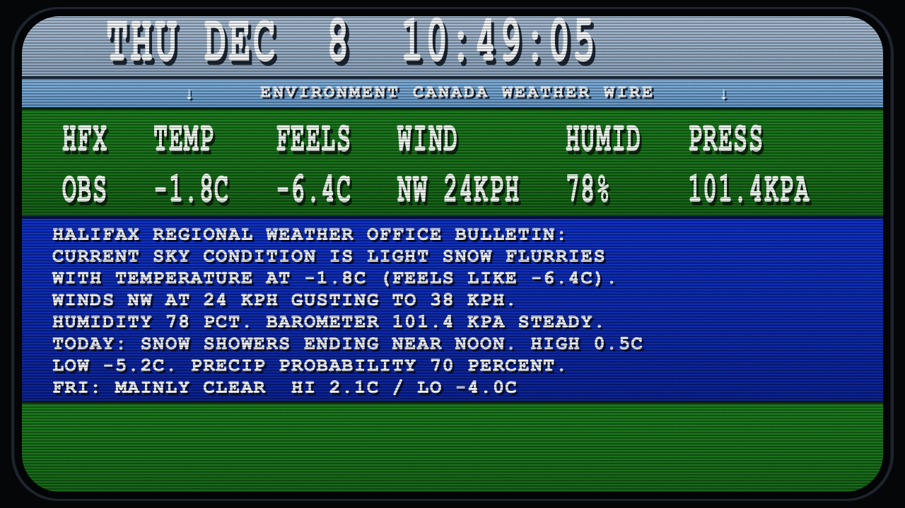
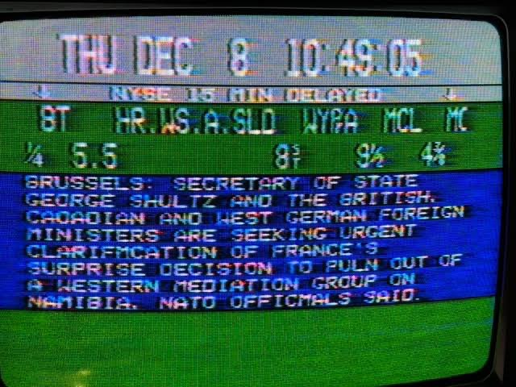
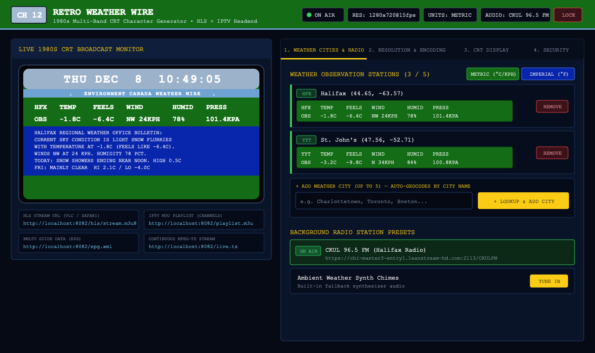

# Retro 1980s CRT Weather Wire — Docker HLS & IPTV Broadcast Server (`retro-weather-hls`)

A self-contained Docker container that recreates a **1980s Multi-Band CRT Character Generator Weather Channel** (modeled after vintage Canadian & North American cable headend weather / wire systems) and broadcasts a continuous **24/7 live HLS (`.m3u8` + `.ts`) and MPEG-TS video stream** paired with live internet radio audio.

---

## Visual Layout & Screenshots

### 1. Live Broadcast Output vs. Original 1980s CRT Reference

| Generated Live HLS Broadcast Frame | Original 1980s CRT Character Generator Reference |
| :---: | :---: |
|  |  |

The video renderer ([`app/renderer.py`](./app/renderer.py)) faithfully reproduces every band of the classic 1980s character generator:
1. **Top Pale Steel-Blue / Silver-Grey Clock Header (`0%–15%`)**: Tall, vertically stretched blocky characters (`THU DEC  8  10:49:05`) ticking every second with a heavy dark drop-shadow.
2. **Thin Sky-Blue Sub-Header Wire Strip (`15%–21%`)**: Centered banner between down-arrows (`↓ ENVIRONMENT CANADA WEATHER WIRE ↓`, customizable in the Admin Portal).
3. **Upper Forest-Green 2-Row Telemetry Band (`21%–42.5%`)**: Classic `#146c16` CRT green displaying tall condensed station observation columns (`HFX   TEMP    FEELS   WIND       HUMID   PRESS` / `OBS   -1.8C   -6.4C   NW 24KPH   78%     101.4KPA`).
4. **Center Deep Royal-Blue 8-Line Forecast Band (`42.5%–79%`)**: Deep `#0826ac` royal blue displaying up to 8 lines of wide, all-caps character-generator teletype text with character-by-character typewriter reveal (cycling through local observation dispatches, 5-day extended outlooks, and optional RSS weather alerts).
5. **Lower Forest-Green Band (`79%–100%`)**: Solid forest green lower band (blank by default like the original CRT display, or optional custom crawler text).
6. **Curved CRT Monitor Bezel & Scanlines**: Super-elliptical curved black CRT monitor bezel, horizontal scanlines, and subtle analog RF grain.

---

### 2. Web Admin Portal & Control Room (`http://localhost:8082/`)



---

## Key Features

- **Zero-API-Key Live Weather ([`app/weather_fetcher.py`](./app/weather_fetcher.py))**:
  - Polls live current observations (temperature, wind chill / apparent temp, wind direction, speed & gusts, relative humidity, barometric surface pressure in `kPa` or `inHg`, and WMO sky condition) plus **5-day daily high/low/precipitation forecasts** from Open-Meteo.
  - **Built-in City Name Geocoder**: Type any city name (e.g., `Halifax`, `St. John's`, `Moncton`, `Toronto`, `Boston`, `Winnipeg`) in the Admin Portal to automatically look up coordinates and 3-letter station codes—up to **5 weather cities** in rotation.
  - **Metric (`°C / KPH / KPA`) & Imperial (`°F / MPH / INHG`)**: Instant one-click unit switching in the Admin Portal.
- **Optional Weather Alert RSS Feeds (Up to 5)**:
  - Add Environment Canada / NWS / local advisory RSS or Atom feeds to interleave weather warning pages into the royal-blue forecast band.
- **Multi-Preset Radio Station Tuner ([`app/streamer.py`](./app/streamer.py))**:
  - Preloaded with **CKUL 96.5 FM** (`https://chi-master3-entry1.leanstream-hd.com:2113/CKULFM`) and an offline synthesizer fallback.
  - Add unlimited Icecast / Shoutcast / MP3 / AAC / HLS radio presets and switch the live broadcast audio on the fly.
- **Live Resolution & Bitrate Switcher**:
  - Switch between **1080p Full HD**, **720p HD (Default)**, **540p Cloud Saver**, **480p SD**, or **480i 4:3 CRT (`640×480`)** with adjustable frame rate (`5–30 fps`) and video bitrate (`350k–2500k`).
- **Operator Login Prompt ([`app/settings_store.py`](./app/settings_store.py))**:
  - Protects the Admin Portal and `/api/*` configuration endpoints with PBKDF2-HMAC-SHA256 password hashing and signed `HttpOnly` session cookies (`admin` / `cable10` by default), while keeping `/hls/stream.m3u8`, `/live.ts`, `/playlist.m3u`, and `/epg.xml` accessible to media players.

---

## Quick Start (Docker Compose)

```bash
cd /Users/matthew/.gemini/antigravity/scratch/retro-weather-hls
docker compose up -d --build
```

> **Note:** By default, [`docker-compose.yml`](./docker-compose.yml) maps host port **`8082`** (`${PORT:-8082}:8080`) so you can run this container side-by-side with `cable-bulletin-hls` (on port `8080`) without port conflicts.

### Stream & Admin Endpoints

| Endpoint | URL | Description |
| :--- | :--- | :--- |
| **Web Admin Portal** | `http://localhost:8082/` | Live CRT monitor, city manager, unit toggle, radio presets, resolution switcher (Default login: `admin` / `cable10`) |
| **HLS Stream (`.m3u8`)** | `http://localhost:8082/hls/stream.m3u8` | Open in VLC, QuickTime, Safari, IINA, OBS, or Apple TV |
| **MPEG-TS Stream** | `http://localhost:8082/live.ts` | Continuous MPEG-TS stream for Channels DVR / Plex / Jellyfin / xTeVe |
| **IPTV M3U Playlist** | `http://localhost:8082/playlist.m3u` | Auto-configured M3U playlist with `tvg-chno="12"` and EPG link |
| **XMLTV Guide (EPG)** | `http://localhost:8082/epg.xml` | Rolling 24-hour XMLTV program guide listing active cities |
| **Live Frame PNG** | `http://localhost:8082/preview.png` | Instant PNG snapshot of the current 5-band CRT broadcast frame |

---

## Environment Variables

All settings can be changed live in the Web Admin Portal (persisted in `./data/settings.json`) or seeded via environment variables in [`docker-compose.yml`](./docker-compose.yml):

| Variable | Default | Description |
| :--- | :--- | :--- |
| `TZ` | `America/Halifax` | Local timezone used for the top steel-blue CRT clock (`THU DEC  8  10:49:05`) |
| `ADMIN_USERNAME` | `admin` | Initial operator login username |
| `ADMIN_PASSWORD` | `cable10` | Initial operator login password |
| `CHANNEL_NUMBER` | `12` | Virtual cable channel number in M3U & XMLTV EPG |
| `CHANNEL_NAME` | `RETRO WEATHER WIRE` | Channel title in Admin Portal, M3U, and EPG |
| `SUBHEADER_TEXT` | `ENVIRONMENT CANADA WEATHER WIRE` | Text inside the sky-blue wire sub-header strip (`↓ ... ↓`) |
| `WEATHER_UNITS` | `metric` | Initial weather telemetry units (`metric` or `imperial`) |
| `AUDIO_STREAM_URL` | `https://chi-master3-entry1.leanstream-hd.com:2113/CKULFM` | Default background radio stream URL |
| `VIDEO_WIDTH` / `VIDEO_HEIGHT` | `1280` / `720` | Initial broadcast resolution |
| `VIDEO_FPS` / `VIDEO_BITRATE` | `15` / `1100k` | Initial frame rate and H.264 target bitrate |
